  <picture>
    <source media="(prefers-color-scheme: dark)" srcset="./assets/banner-dark.svg" />
    <source media="(prefers-color-scheme: light)" srcset="./assets/banner-light.svg" />
    
  </picture>

 

Data + AI at **Alibaba Cloud**. I work on **Ray** — large-scale heterogeneous clusters, distributed runtimes, and the data pipelines that run on them.

  
  
  
  
  
  
  

### Focus

| Heterogeneous Clusters | Data at Scale | Runtime Internals |
| :--- | :--- | :--- |
| Resource topology, topology-aware scheduling, and making mixed accelerator pools behave reliably under load. | **Ray Data** pipelines, **MaxFrame** (distributed pandas on ODPS), and high-throughput **Parquet & Lance** I/O. | Object store memory management, transports, and the failure modes that only surface at cluster scale. |

### Open Source

| Project | Role & Context |
| :--- | :--- |
| [**ray-project/ray**](https://github.com/ray-project/ray) | Distributed AI compute engine — core runtime & Ray Data |
| [**aliyun/alibabacloud-odps-maxframe-client**](https://github.com/aliyun/alibabacloud-odps-maxframe-client) | Distributed pandas & Python compute framework on Alibaba Cloud MaxCompute (ODPS) |
| [**huangcarry/velastest**](https://github.com/huangcarry/velastest) | Lance & multimodal data pipeline snippets — CSV/JSON to Lance, image resampling, vision & T2I |

### Activity

  <picture>
    <source media="(prefers-color-scheme: dark)" srcset="https://raw.githubusercontent.com/huangcarry/huangcarry/output/github-contribution-grid-snake-dark.svg" />
    <source media="(prefers-color-scheme: light)" srcset="https://raw.githubusercontent.com/huangcarry/huangcarry/output/github-contribution-grid-snake.svg" />
    
  </picture>

